<!-- ANFAL ENTERPRISES | WAREHOUSE README -->

<div align="center">


<a href="https://github.com/SyedRaqi/Anfal">
  
</a>

<br/>

<a href="#-the-supply-chain"></a>
&nbsp;
<a href="#-the-last-mile"></a>
&nbsp;
<a href="#-loading-dock"></a>
&nbsp;
<a href="#-the-warehouse-floor"></a>

<br/><br/>


</div>


## 📦 Dispatch Note

> **Anfal Enterprises is a wholesale distributor for FMCG, connecting trusted brands with retailers, hotels, institutions and caterers.**

This repository is a **dummy website for enterprises**: a single-page, responsive marketing site for that business, built as one `index.html` with no build step.

## 🧱 The Warehouse Floor

The page walks visitors through the business the way a delivery walks through a warehouse, one numbered section at a time.

| 📍 BAY | 🏷️ SECTION | 💬 THE POINT |
|:-:|---|---|
| Hero | **Anfal Enterprises** | "Wholesale distribution, redefined." Trust. Range. Reliability. |
| 01 | About Anfal | Powering FMCG distribution with reliability |
| 02 | Our portfolio | Our trusted brands |
| 03 | What we do | The details make the difference |
| 04 | Who we serve | Built for businesses that keep going |
| 05 | The network | A clear path from brand to business |
| 06 | Why Anfal | A partner with the bigger picture in view |
| 07 | Start a conversation | Let's move business forward |

### Four pillars on the racks

<div align="center">
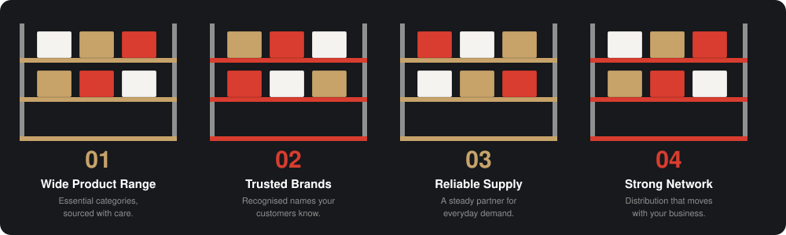
</div>

## 📥 Goods In

<div align="center">
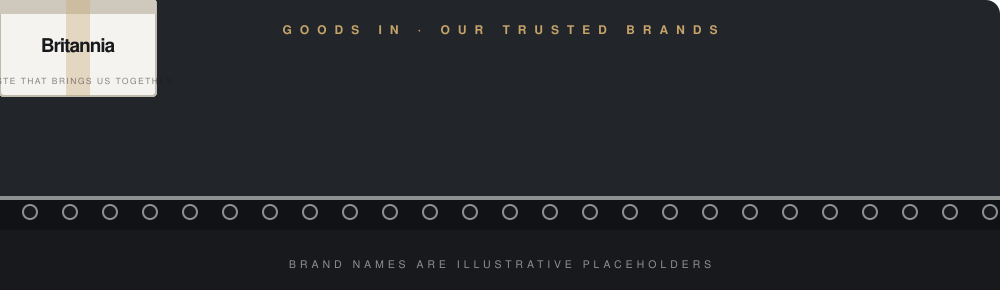
</div>

<br/>

The portfolio section lines up six household names: Hindustan Unilever, P&G, Nestlé, Dabur, Tata, and Britannia. Each card pairs a logo (or a lettermark) with a one-line promise. Hovering a card lifts it and warms its border to gold.

## 🛠️ What We Do

<div align="center">
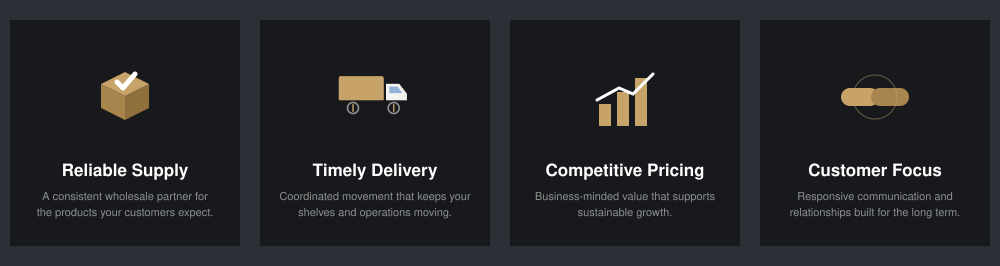
</div>

## 🚚 The Last Mile

<div align="center">
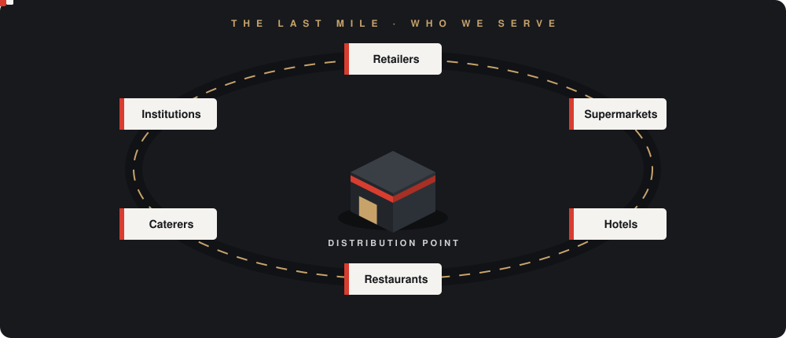
</div>

<br/>

Anfal serves **retailers, supermarkets, hotels, restaurants, caterers, and institutions**.

## 🏭 The Supply Chain

<div align="center">
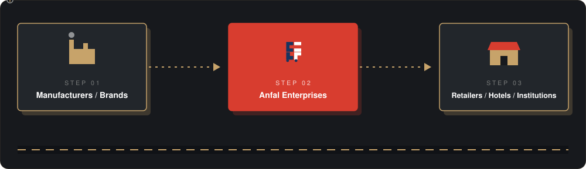
</div>

<br/>

The network section boils the business down to three steps: **Manufacturers / Brands**, then **Anfal Enterprises**, then **Retailers / Hotels / Institutions**. Anfal's job is to make the route between them more dependable.

## 🧾 Why Anfal

<div align="center">
</div>


## 🎨 The Brand Palette

<div align="center">
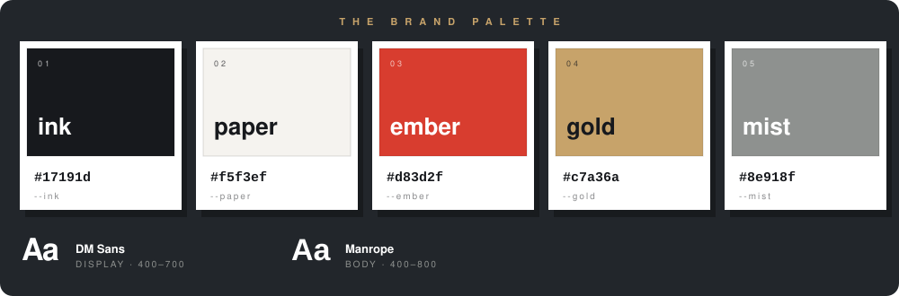
</div>

<br/>

| 🎨 TOKEN | HEX | USED FOR |
|---|---|---|
| `ink` | `#17191d` | Dark sections, text, the browser theme color |
| `paper` | `#f5f3ef` | Page background |
| `ember` | `#d83d2f` | Accents, calls to action, section numbers |
| `gold` | `#c7a36a` | Hairlines, icons, hover highlights |
| `mist` | `#8e918f` | Quiet secondary tone |

Headlines use **DM Sans** (the `display` family) and body copy uses **Manrope**, both loaded from Google Fonts.

## ✨ Quality Control

<div align="center">
</div>

<br/>

- 🎬 Sections **fade up** as they scroll into view, using an `IntersectionObserver`.
- 🧭 The nav starts transparent over the hero and turns **solid** after a short scroll.
- 📱 A **mobile menu** toggles with a hamburger that swaps to an X and keeps `aria-expanded` in sync.
- ♿ Visitors who enable **reduced motion** get instant reveals, no smooth scrolling, and near-zero transitions.
- 🖼️ If the hero photo is missing, a **gradient fallback** takes over, and any broken `` hides itself instead of showing a broken icon.
- ⚓ In-page links **glide** to their sections.

## 🚛 Loading Dock

No installs, no build. It's one HTML file.

**Step 1 · Grab the code**

```bash
git clone https://github.com/SyedRaqi/Anfal.git
cd Anfal
```

**Step 2 · Serve it on port 8080**

The included `launch.json` expects the site at `http://localhost:8080`. Any static server works; for example:

```bash
python -m http.server 8080
```

Then open http://localhost:8080.

> 🌐 **Needs internet:** the page loads Tailwind (CDN), Lucide icons (unpkg), Google Fonts, and brand favicons from Google's favicon service.

> 🧩 **VS Code tip:** `launch.json` defines a "Launch Chrome against localhost:8080" debug configuration. VS Code looks for it inside a `.vscode/` folder, so move it there to use it.

## 📋 Pallet Manifest

<div align="center">
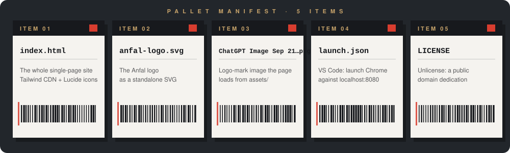
</div>

<br/>

| 📦 ITEM | 📝 WHAT IT IS |
|---|---|
| `index.html` | The entire site: markup, styles, and scripts in one file |
| `anfal-logo.svg` | The Anfal logo as a standalone SVG |
| `ChatGPT Image Sep 21, 2026, 05_53_41 PM.png` | The logo-mark image the page uses for its favicon and logo marks |
| `launch.json` | VS Code debug configuration for Chrome on `localhost:8080` |
| `LICENSE` | The Unlicense |

## 🧾 A Note on Brand Names

The six brand names in the portfolio section are illustrative placeholders in this dummy site, and their logos come from Google's favicon service. Nothing here implies a partnership with, or endorsement by, those companies.

## 📜 License

Released under the [Unlicense](LICENSE). Take it, adapt it, make it your own.

<div align="center">

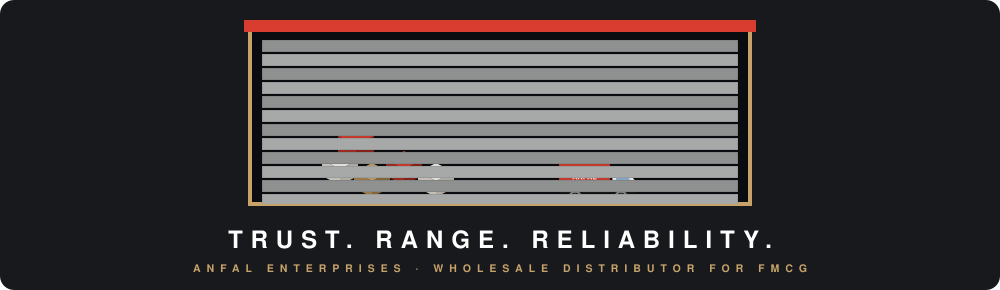

**Anfal Enterprises** · Built by [Syed Raqi](https://github.com/SyedRaqi) · [⭐ Star the repo](https://github.com/SyedRaqi/Anfal)

<sub>A dummy website for enterprises. Trust. Range. Reliability.</sub>

</div>
